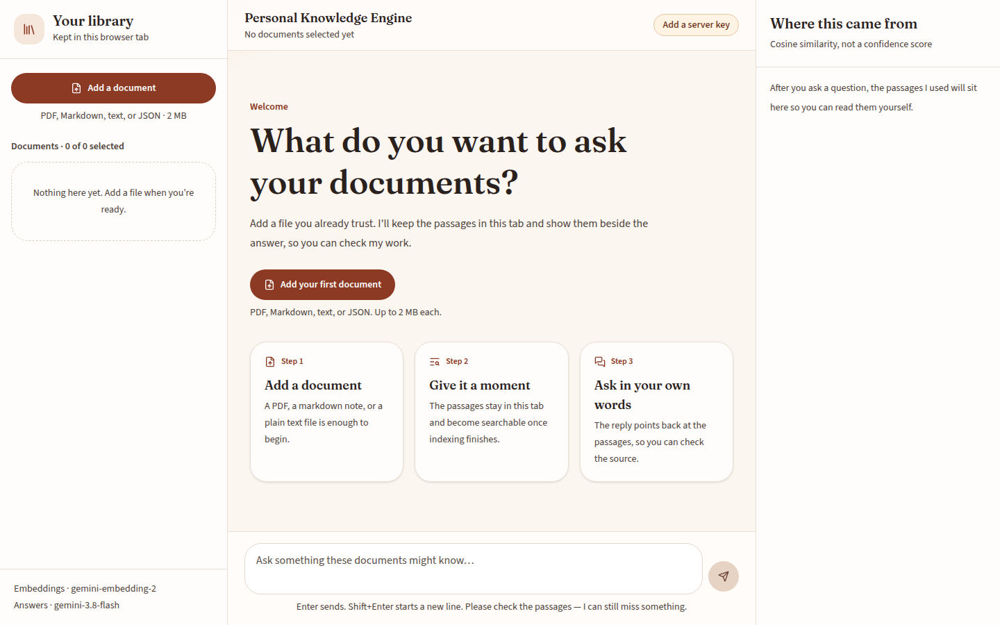
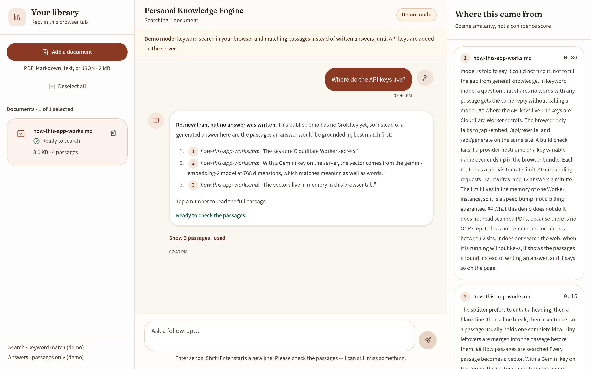
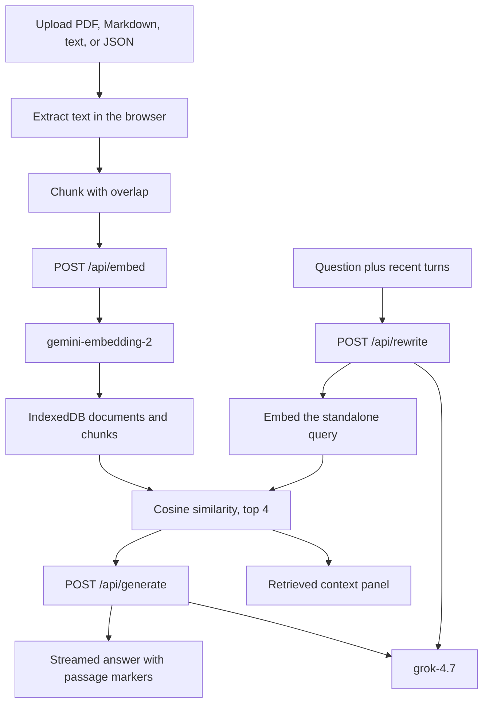

# Personal Knowledge Engine

A retrieval-augmented generation app for your own documents. It chunks what you upload, embeds the chunks with Gemini, and streams a Grok answer that cites the passages it actually retrieved.

The vector index stays in this browser, in IndexedDB. Both API keys stay on the server.

[](https://github.com/kfairy9999/Retrieval-Augmented-Generation/actions/workflows/ci.yml)




The header pill comes from `/api/health`, which reports whether each key exists, never its value.

**Live demo:** [personal-knowledge-engine.kfairley9999.workers.dev](https://personal-knowledge-engine.kfairley9999.workers.dev). Open it, tap **Try the sample document**, then tap a suggested question.

The public deployment does not have API keys yet, so it runs in a labeled **demo mode**: search uses keyword vectors computed in the browser instead of Gemini embeddings, and instead of a written Grok answer it shows the passages that matched, best first, with clickable citations. That retrieval is real; nothing on the page is pre-written output. Once both secrets are set (see [Deploy](#deploy-to-cloudflare)), the same page switches to Gemini embeddings and streamed Grok answers with no code change.



## What it does

- Upload several PDF, Markdown, text, or JSON files. Text is extracted in the browser. PDF.js reads digital PDFs; scanned pages are rejected because there is no OCR.
- Split each file into roughly 1,000-character chunks with 200 characters of overlap, breaking on markdown headings, paragraphs, and sentences when it can.
- Embed those chunks with Gemini `gemini-embedding-2` (768 dimensions) and rank them against the question with cosine similarity. Search is limited to the documents you select.
- Stream an answer from xAI `grok-4.7`. The model is told to use only the retrieved passages and to cite them as `[1]`, `[2]`, and so on.
- Click a citation to scroll the matching passage. The context panel shows the passage text and its cosine score.
- Ask a follow-up. When there is conversation history, Grok rewrites the question into a standalone search query, Gemini embeds that query, and the answer still sees the recent turns.
- If the selected documents have no matching chunks, it says so and does not call the generator.
- Delete a document and its chunks and vectors. A refresh or a closed tab keeps the library. A clear control removes every saved document from this browser. The bundled sample, if you load it, is stored the same way and stays labeled as a demo.

## Architecture



Ingestion and retrieval run in the page. The dev server, and the Cloudflare Worker in production, proxy two providers. `/api/embed` calls Gemini. `/api/rewrite` and `/api/generate` call Grok. A request sends chunk text to be embedded, or the question, a short history, and the top passages to be answered. The original file is not stored on the server. On load the page reads the same IndexedDB database and restores documents and vectors. If IndexedDB cannot be opened, or a write runs out of space, the page says so and keeps that session in memory only.

## Engineering decisions

These are the choices in this repo, not a claim about production RAG in general.

**The index stays on this device.** Passages and vectors are IndexedDB records in the browser, in two collections. `documents` holds id, name, type, size, createdAt, chunkCount, and capHit, plus a demo flag for the bundled sample. `chunks` holds id, documentId, text, a heading when the passage has one, the source metadata, and the embedding as a Float32Array (768 numbers for Gemini; longer for the keyword demo). Deleting a document deletes its chunks in the same transaction. The page reads that database on load, so a refresh or a closed tab does not make you upload again. Original files are not kept. Nothing is written to the Worker, and there is no server-side database. If the browser refuses IndexedDB, or a write runs out of space, the page says so and uses memory for that session only.

**The API keys are not in the bundle.** The original AI Studio project injected `GEMINI_API_KEY` with Vite `define`, so a public deploy would have shipped the key. The browser now calls `/api/embed`, `/api/rewrite`, and `/api/generate`. Locally those routes are Vite middleware. In production they are a Worker, and static files are Workers assets. `npm run check:bundle` fails the build if the client output contains either key name or either provider host.

**Answers use Grok because that is the current text model. Embeddings stay on Gemini because xAI's model list has no embedding model.** Checked against [docs.x.ai/docs/models](https://docs.x.ai/docs/models) on November 9, 2026: the listed models are text, image, video, and voice. There is no public endpoint that turns a string into a vector. Collections can index uploaded files with an internal `grok-embedding-small` setting, but that stores documents in xAI and does not return vectors for this browser index. So `/api/embed` still calls `gemini-embedding-2`. `/api/rewrite` and `/api/generate` call `grok-4.7` at `POST https://api.x.ai/v1/chat/completions` with a Bearer `XAI_API_KEY`. Streaming follows the documented SSE shape: answer text is `choices[].delta.content`, reasoning is `choices[].delta.reasoning_content` and is not shown, and the stream ends with `data: [DONE]`. Reasoning effort is `low`. Sampling uses `temperature` 0.7 and `top_p` 0.95.

**Embeddings use the current task format.** `text-embedding-004` was shut down. `gemini-embedding-2` does not take `taskType`. Documents are embedded as `title: … | text: …` and questions as `task: question answering | query: …`, which is the asymmetric format in the Gemini embeddings docs. Vectors are requested at 768 dimensions. Cosine similarity is a score, and the UI does not call it a probability.

**Chunking is a character window.** The splitter prefers a heading, blank line, or sentence in the second half of the window, then overlaps the next window by 200 characters. It is not token-aware and it is not a semantic chunker. Each document is capped at 80 chunks so one upload cannot fan out into hundreds of embedding calls. The card says when that cap is hit.

**Follow-ups are rewritten before search.** "What about the second one?" is a poor embedding query. With history present, `/api/rewrite` asks Grok for one standalone line. If that call fails, retrieval uses the raw question. Generation still receives the recent turns, and the system prompt says those turns are not evidence.

**Citations are instructed, then range-checked.** The prompt numbers the passages and asks for markers like `[1]`. The UI turns an in-range marker into a button. A marker outside that range, and markers inside code, stay plain text. Nothing here checks that the sentence is entailed by the passage.

**Empty retrieval skips generation.** No chunks means a fixed "I couldn't find relevant passages" reply. If chunks exist, they are shown with scores and the model may still decline.

**Streaming drops reasoning deltas.** `/api/generate` proxies the Grok chat-completions stream and forwards only `delta.content`. Reasoning effort is `low` so a short grounded answer is less likely to wait on a long trace. Grok cannot turn reasoning off.

**The rate limit is local.** Each route has a sliding window keyed by a hash of the client IP: 40 embed calls, 12 rewrites, and 12 generations per minute. Bodies are capped at 128 KB, embed batches at 16 texts, and answers at 6 passages. On Workers the counters live in one isolate, so this is a demo brake, not an account-wide quota.

**Tests do not call Gemini or Grok.** They cover chunk boundaries, cosine ranking, the document filter, failed and cancelled indexing, IndexedDB restore, delete cascade, an empty database, quota and unavailable fallbacks, citation linking, the prompt text, SSE parsing, and the HTTP limits, including mocked Grok response bodies. `npm run eval:retrieval` repeats the offline ranking checks. If `GEMINI_API_KEY` is set, it also embeds three short passages and expects the plant sentence to rank first for a plant question. That live check is skipped in CI.

## Stack

| Piece | Choice |
| --- | --- |
| UI | React 19, Tailwind CSS 4 |
| Build | Vite 6 |
| PDF text | PDF.js, loaded only when a PDF is uploaded |
| Embeddings | Gemini `gemini-embedding-2`, 768 dimensions |
| Answers | xAI `grok-4.7` via chat completions, streamed |
| Retrieval | In-browser cosine similarity |
| Library | IndexedDB in the browser (`documents` and `chunks`) |
| Server | Vite middleware locally, Cloudflare Worker plus static assets in production |
| Tests | Vitest |

## Run locally

Node.js 22 or newer.

```bash
npm install
cp .env.example .env
# Put GEMINI_API_KEY and XAI_API_KEY in .env. Do not commit that file.
npm run dev
```

Open `http://localhost:3000`. The header pill says whether the dev server can see each key. Indexing fails until `GEMINI_API_KEY` is set. Answers and follow-up rewrites fail until `XAI_API_KEY` is set.

`npm run dev` is the local path. It reads `.env` and passes the key only to the API middleware. Do not also create a `.dev.vars` file if you want Wrangler to read the same `.env`; Wrangler ignores `.env` when `.dev.vars` exists.

```bash
npm test
npm run typecheck
npm run lint
npm run eval:retrieval
npm run build && npm run preview
```

## Deploy to Cloudflare

Deployed November 10, 2026 as the Worker `personal-knowledge-engine` at [personal-knowledge-engine.kfairley9999.workers.dev](https://personal-knowledge-engine.kfairley9999.workers.dev). Neither secret is set yet, so the live site runs in demo mode.

The Worker is configured in `wrangler.jsonc`: static assets from `dist/`, `/api/*` handled by `worker/index.ts` before the SPA fallback, Workers Logs, traces sampled at 1%, and both `GEMINI_API_KEY` and `XAI_API_KEY` declared as required secrets. Compatibility date is 2026-11-08.

```bash
npx wrangler login
npm run deploy
```

`npm run deploy` builds the client and runs `wrangler deploy`. The same command is in `scripts/deploy.sh`.

A deploy that declares `secrets.required` fails until both secrets are set on the Worker. Set each one without putting the value in the shell history:

```bash
npx wrangler secret put GEMINI_API_KEY
npx wrangler secret put XAI_API_KEY
```

Paste the key at each prompt. Each command stores that secret and publishes a new Worker version. You can also add both secrets in the dashboard under the Worker's settings, then run `npm run deploy` again. Do not put either key in `wrangler.jsonc` or in git.

Preview URLs are public unless you add an access policy.

`npx wrangler dev`, after a build, runs the Worker and the static assets locally. It reads both keys from `.env` when `.dev.vars` is absent.

### Demo mode without keys

`/api/health` reports which keys exist, never their values. Without `GEMINI_API_KEY`, `src/lib/keyword.ts` turns each passage into a 4,096-slot hashed bag of words (stop words removed, light stemming, sublinear term frequency) and ranks with the same cosine similarity, so `rankChunks` is unchanged. Keyword search matches words, not meaning. Without `XAI_API_KEY`, the app skips the follow-up rewrite and the answer call and lists the retrieved passages instead. A banner and the header pill say which mode is on. `tests/keyword.test.ts` checks that the bundled sample's "Where do the API keys live?" question ranks the right section first.

## Limitations and next steps

- The library is IndexedDB in this browser profile. It is not synced to other devices. A private window may refuse storage. Clearing site data, or the in-app control, deletes it. Vectors saved in demo mode are keyword vectors; adding a Gemini key later does not re-embed them.
- There is no shared corpus, so a public demo still asks every visitor to upload files and spend embedding quota.
- Retrieval is cosine over Gemini embeddings only. There is no lexical search, no reranker, and no measured recall on a public benchmark.
- The offline eval checks the ranker with hand-built vectors. It does not measure the embedding model. The optional live check is three sentences, not a dataset.
- Citations depend on the model emitting the requested markers.
- Chunks are character windows, not tokens, and long files keep only the first 80 chunks.
- Scanned PDFs are unsupported.
- The rate limit does not coordinate across Worker isolates. A public demo also needs quota alerts on both the Gemini key and the Grok key.
- Passage text is sent to Gemini to be embedded and to Grok to be answered. Do not upload documents you cannot send to those APIs.
- Chat completions does not accept the Responses API `store` flag. Passage text is still sent to xAI for the answer. Do not treat that as a promise that xAI discards the request.

## License

MIT. See [LICENSE](LICENSE).
