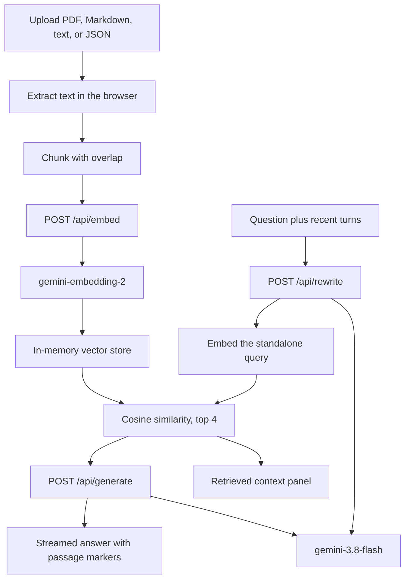

# Personal Knowledge Engine

A retrieval-augmented generation app for your own documents. It chunks what you upload, embeds the chunks with Gemini, and streams an answer that cites the passages it actually retrieved.

The vector index stays in the browser tab. The Gemini API key stays on the server.

[](https://github.com/kfairy9999/Retrieval-Augmented-Generation/actions/workflows/ci.yml)


The header pill still comes from `/api/health`. It does not mean the browser was given a key.

**Live demo:** _Not deployed. This repository includes the Cloudflare config, and the URL can go here after the first deploy._

## What it does

- Upload several PDF, Markdown, text, or JSON files. Text is extracted in the browser. PDF.js reads digital PDFs; scanned pages are rejected because there is no OCR.
- Split each file into roughly 1,000-character chunks with 200 characters of overlap, breaking on markdown headings, paragraphs, and sentences when it can.
- Embed those chunks with `gemini-embedding-2` (768 dimensions) and rank them against the question with cosine similarity. Search is limited to the documents you select.
- Stream an answer from `gemini-3.8-flash`. The model is told to use only the retrieved passages and to cite them as `[1]`, `[2]`, and so on.
- Click a citation to scroll the matching passage. The context panel shows the passage text and its cosine score.
- Ask a follow-up. When there is conversation history, the app asks the model for a standalone search query, embeds that query, and still shows the recent turns to the answer model.
- If the selected documents have no matching chunks, it says so and does not call the generator.
- Delete a document and its vectors. Refreshing the tab clears the index.

## Architecture



Ingestion and retrieval run in the page. The dev server, and the Cloudflare Worker in production, only proxy Gemini. A request sends chunk text to be embedded, or the question, a short history, and the top passages to be answered. The original file is not stored on the server.

## Engineering decisions

These are the choices in this repo, not a claim about production RAG in general.

**The index stays in the tab.** Chunks and vectors live in a module-level store. That keeps a personal demo from uploading whole documents, and it means a refresh wipes the index. There is no database.

**The API key is not in the bundle.** The original AI Studio project injected `GEMINI_API_KEY` with Vite `define`, so a public deploy would have shipped the key. The browser now calls `/api/embed`, `/api/rewrite`, and `/api/generate`. Locally those routes are Vite middleware. In production they are a Worker, and static files are Workers assets. `npm run check:bundle` fails the build if the client output contains the key name or the Gemini host.

**Embeddings use the current task format.** `text-embedding-004` was shut down. `gemini-embedding-2` does not take `taskType`. Documents are embedded as `title: … | text: …` and questions as `task: question answering | query: …`, which is the asymmetric format in the Gemini embeddings docs. Vectors are requested at 768 dimensions. Cosine similarity is a score, and the UI does not call it a probability.

**Chunking is a character window.** The splitter prefers a heading, blank line, or sentence in the second half of the window, then overlaps the next window by 200 characters. It is not token-aware and it is not a semantic chunker. Each document is capped at 80 chunks so one upload cannot fan out into hundreds of embedding calls. The card says when that cap is hit.

**Follow-ups are rewritten before search.** "What about the second one?" is a poor embedding query. With history present, `/api/rewrite` asks for one standalone line. If that call fails, retrieval uses the raw question. Generation still receives the recent turns, and the system prompt says those turns are not evidence.

**Citations are instructed, then range-checked.** The prompt numbers the passages and asks for markers like `[1]`. The UI turns an in-range marker into a button. A marker outside that range, and markers inside code, stay plain text. Nothing here checks that the sentence is entailed by the passage.

**Empty retrieval skips generation.** No chunks means a fixed "I couldn't find relevant passages" reply. If chunks exist, they are shown with scores and the model may still decline.

**Streaming drops thought parts.** `/api/generate` proxies `streamGenerateContent` and forwards only non-thought text. Thinking level is set to `low` so a short grounded answer is less likely to spend the output budget on a reasoning trace. Sampling temperature is left at the model default.

**The rate limit is local.** Each route has a sliding window keyed by a hash of the client IP: 40 embed calls, 12 rewrites, and 12 generations per minute. Bodies are capped at 128 KB, embed batches at 16 texts, and answers at 6 passages. On Workers the counters live in one isolate, so this is a demo brake, not an account-wide quota.

**Tests do not call Gemini.** They cover chunk boundaries, cosine ranking, the document filter, failed and cancelled indexing, citation linking, the prompt text, SSE parsing, and the HTTP limits. `npm run eval:retrieval` repeats the offline ranking checks. If `GEMINI_API_KEY` is set, it also embeds three short passages and expects the plant sentence to rank first for a plant question. That live check is skipped in CI.

## Stack

| Piece | Choice |
| --- | --- |
| UI | React 19, Tailwind CSS 4 |
| Build | Vite 6 |
| PDF text | PDF.js, loaded only when a PDF is uploaded |
| Embeddings | `gemini-embedding-2`, 768 dimensions |
| Answers | `gemini-3.8-flash`, streamed |
| Retrieval | In-browser cosine similarity |
| Server | Vite middleware locally, Cloudflare Worker plus static assets in production |
| Tests | Vitest |

## Run locally

Node.js 22 or newer.

```bash
npm install
cp .env.example .env
# Put your Gemini API key in .env. Do not commit that file.
npm run dev
```

Open `http://localhost:3000`. The header pill says whether the dev server can see `GEMINI_API_KEY`. Indexing and answers fail with an explicit error until it can.

`npm run dev` is the local path. It reads `.env` and passes the key only to the API middleware. Do not also create a `.dev.vars` file if you want Wrangler to read the same `.env`; Wrangler ignores `.env` when `.dev.vars` exists.

```bash
npm test
npm run typecheck
npm run lint
npm run eval:retrieval
npm run build && npm run preview
```

## Deploy to Cloudflare

This repo is not deployed. Nothing here has been published to a Workers subdomain.

The Worker is configured in `wrangler.jsonc`: static assets from `dist/`, `/api/*` handled by `worker/index.ts` before the SPA fallback, Workers Logs, traces sampled at 1%, and `GEMINI_API_KEY` declared as a required secret. Compatibility date is 2026-11-08.

```bash
npx wrangler login
npm run deploy
```

`npm run deploy` builds the client and runs `wrangler deploy`. The same command is in `scripts/deploy.sh`.

A deploy that declares `secrets.required` fails until `GEMINI_API_KEY` is set on the Worker. Set it without putting the key in the shell history:

```bash
npx wrangler secret put GEMINI_API_KEY
```

Paste the key at the prompt. That command stores the secret and publishes a new Worker version. You can also add `GEMINI_API_KEY` in the dashboard under the Worker's settings, then run `npm run deploy` again. Do not put the key in `wrangler.jsonc` or in git.

After deploy, the Workers URL is the live demo. Put it in the placeholder at the top of this file. Preview URLs are public unless you add an access policy.

`npx wrangler dev`, after a build, runs the Worker and the static assets locally. It reads `GEMINI_API_KEY` from `.env` when `.dev.vars` is absent.

## Limitations and next steps

- The index is memory in one tab. Refreshing loses it. A durable version would use something like Cloudflare Vectorize or a local database.
- There is no shared corpus, so a public demo still asks every visitor to upload files and spend embedding quota.
- Retrieval is cosine over Gemini embeddings only. There is no lexical search, no reranker, and no measured recall on a public benchmark.
- The offline eval checks the ranker with hand-built vectors. It does not measure the embedding model. The optional live check is three sentences, not a dataset.
- Citations depend on the model emitting the requested markers.
- Chunks are character windows, not tokens, and long files keep only the first 80 chunks.
- Scanned PDFs are unsupported.
- The rate limit does not coordinate across Worker isolates. A public demo also needs a quota alert on the Gemini key.
- Passage text is sent to Gemini for embedding and for the answer. Do not upload documents you cannot send to that API.

## License

MIT. See [LICENSE](LICENSE).
